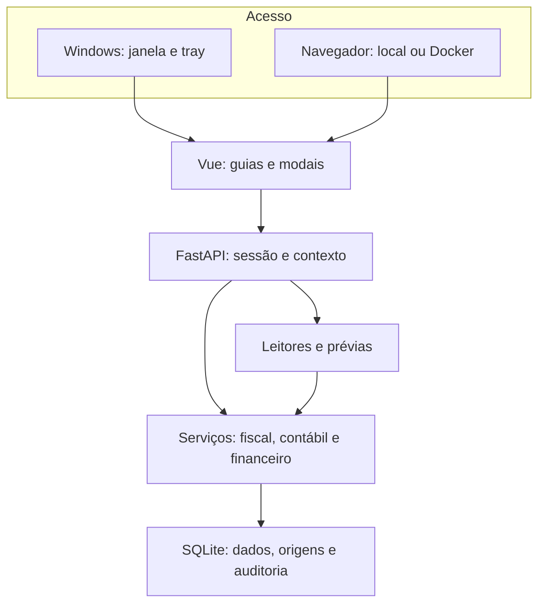

> Documento histórico da implementação inicial. Consulte o [diagnóstico 0.5](DIAGNOSTICO_EXPANSAO_0_5.md), a [operação](OPERACAO_0_5.md) e a [validação atual](VALIDACAO_0_5.md).

# Análise das referências e proposta da Escritura Integrada

**Data:** 06/11/2026 · **Aplicação nova:** 0.4.0-dev.1.

Registro da análise inicial, anterior à implantação do fluxo CI/CD. O repositório público contém a implementação nova e este resumo. Os binários, prints originais, pseudocódigo e catálogos privados usados na investigação foram entregues separadamente ao responsável e não são redistribuídos aqui. Para o estado atual de builds e ambientes, consulte `CI_CD.md`, `DEPLOY.md` e os runs de release.

A proposta é uma aplicação integrada para o escritório, com um cadastro de empresas, uma área de trabalho e o mesmo núcleo fiscal, contábil e financeiro no Windows e no Docker. O material recebido serve para identificar necessidades, campos e contratos que merecem continuidade. A implementação é nova, separada dos sistemas anteriores.

Os projetos de análise dos executáveis não equivalem aos projetos-fonte originais completos. Formulários recuperados, metadados VB6, Assembly e pseudocódigo permitem verificar partes do programa; não recuperam automaticamente componentes externos, estrutura original de compilação, dependências, regras completas ou comportamento validado em execução. Nenhum executável legado foi executado nesta análise.

## 1. Material examinado e força da evidência

| Conjunto | Exame realizado | O que ele sustenta | Limite |
|---|---|---|---|
| `Projetos_Engenharia_Reversa.zip` | Leitura dos 18 binários e dos catálogos de recuperação, interfaces, assinaturas, literais e pseudocódigo | Identidade de telas, campos, métodos, dependências citadas e determinados despachos de rotina | Não prova execução correta, completude ou validade fiscal |
| Prints recebidos | Inspeção visual de 41 PNGs, com 40 conteúdos únicos | Composição de telas, rótulos, versões e opções efetivamente visíveis | Não prova persistência, cálculos ou resultado de clicar em uma opção |
| `escritura-0.3.0-dev.6.1-source.zip` | Extração com verificação de caminhos, links e limites; leitura de 153 entradas | Contratos e implementação parcial do projeto anterior Python/Vue | Não demonstra que seus testes, builds ou integrações foram executados nesta análise |
| Implementação 0.4.0-dev.1 | Código novo, contrato HTTP e testes de invariantes | Comportamentos implementados e verificáveis no novo projeto | Testes técnicos, avaliação de interface, homologação fiscal e validação de distribuição são verificações distintas |

O inventário recuperado registra **861 objetos VB6, 281 interfaces e 15.877 controles**. Há 20.642 funções nativas elegíveis no inventário, 18.994 com pseudocódigo emitido e 1.648 falhas de descompilação. Esses números descrevem a recuperação; não representam uma porcentagem de regras de negócio reconstruídas. Um acessor simples e uma rotina de cálculo extensa não têm o mesmo peso. O estado `success` significa que o descompilador produziu uma saída, sem certificar tipos, dependências ou correção. [R1]

Dos 41 prints, 37 arquivos foram classificados como telas da aplicação no escopo, três como referências trabalhistas fora do escopo atual e um como captura de conversa. O par `033416`/`033417` é duplicado. Não foram transcritos nomes, documentos, endereços ou valores pessoais dos prints. As capturas de folha/eSocial não ampliam o pedido para uma aplicação de recursos humanos. [R2]

### Identificação dos pacotes

| Pacote | SHA-256 do original analisado |
|---|---|
| `Projetos_Engenharia_Reversa.zip` | `fefd594930d9dc5fae924d51ef5e0e6c60152a00e4c030f11611418e42831872` |
| `escritura-0.3.0-dev.6.1-source.zip` | `2bd82945fc4f94e4e95dd142acd1a60295b95ccc3a5c54e7e76c130b6756c0ec` |

Os hashes identificam os arquivos usados na análise. Não são assinatura de procedência nem validação do comportamento do software. [R1, R3]

## 2. Finalidade dos 18 executáveis

As finalidades abaixo resultam dos títulos, interfaces e metadados recuperados. A coluna de destino descreve a decisão para o produto novo; não declara que todas as opções históricas já foram implementadas. [R1, R2]

| Executável | Versão identificada | Finalidade da referência | Destino no produto novo |
|---|---:|---|---|
| `PRG010100.EXE` | 5.178 | Cadastro de empresas | Empresas com consulta, edição em modal e ativação explícita; parametrizações organizadas por empresa |
| `CTB010100.EXE` | 5.85 | Plano de contas | Plano dentro de Contabilidade, com acesso e classificador separados, natureza, tipo e centro de custo |
| `CTB020100.EXE` | 5.56 | Digitação de lançamentos contábeis | Modal de partidas com data, documento, histórico, contas, centros e equilíbrio validado no servidor |
| `CTB020400.EXE` | 5.105 | Razão contábil | Razão por conta na central de relatórios |
| `CTB020600.EXE` | 5.52 | Diário geral/individual | Diário na mesma central, a partir das partidas registradas |
| `CTB020700.EXE` | 5.12 | Razão por centro de custo | Filtro por centro de custo no Razão; sem executável próprio |
| `CTB020800.EXE` | 5.46 | Diário consolidado | Consolidação fica como evolução sujeita à definição de empresas, estabelecimentos e eliminações |
| `CTB020900.EXE` | 5.92 | Conciliação contábil V4 | Referência para importação bancária, conferência e separação entre sugestões e vínculos |
| `CTB020900A.EXE` | 5.42 | Conciliação contábil anterior | Referência distinta de confronto entre origem e baixa; não presumida como outro leitor bancário |
| `CTB021300.EXE` | 5.23 | Balancete de verificação em tela | Balancete consultável na central de relatórios |
| `CTB021400.EXE` | 5.130 | Balancete de verificação | Mesmo relatório; níveis, modelos históricos e tratamento de resultado exigem especificação adicional |
| `CTB021500.EXE` | 5.07 | Balancete em tela por centro de custo | Centro de custo como dimensão do Balancete |
| `CTB021700.EXE` | 5.13 | Balancete sintético consolidado por centro de custo | Agrupamentos e consolidação futura, após definição de critérios e rateios |
| `CTB030200.EXE` | 5.189 | Relatórios do balanço | Área de relatórios; demonstrações, encerramento e transferência de resultado não foram presumidos |
| `LFSDOCTOS.EXE` | 5.701 | Digitação de documentos fiscais | Documentos e itens, tributos declarados, origem, conferência e contabilização explicitamente escolhida |
| `LFSCTAPAGREC.EXE` | 5.87 | Contas a pagar e receber | Títulos e baixas separados, com saldo, vínculo documental e integração contábil opcional |
| `LFSLIVROS.EXE` | 5.146 | Impressão de documentos/livros fiscais | Requisitos para futura emissão de livros fiscais por perfil; a entrega atual oferece relatórios contábeis internos |
| `LFSLIVROSAPUR.EXE` | 5.25 | Livros e demonstrativos de apuração | Separação entre cálculo, conferência e apresentação; motor legal de apuração depende de validação própria |

Há dependências externas relevantes. O cadastro de empresas cita `PROEMPCTB.DLL`, `PROEMPLFS.DLL` e `PROEMPGER.DLL`. A conciliação anterior cita `Wkb.Contabil.Plugins.Conciliacao`. O corpo dessas integrações não se torna disponível apenas porque seus nomes aparecem no EXE. [R1]

## 3. Conciliação V4 e referência anterior

### O que foi confirmado na V4

O print `image(20261106-041236).png` identifica **Conciliação Contábil versão 4 — 5.92.0.0** e apresenta os modos Bancária, Clientes/Fornecedores e Manual. Banco, leiaute, arquivo, conta, período e estado são visíveis. As cinco extensões não são comprovadas por esse print isoladamente. [R2]

No `CTB020900.EXE`, a rotina `clsNExtratos__RetornarRsExtrato`, endereço `0x006DD200`, despacha **TXT, CSV, OFX, QIF e OFC**. A associação entre slots privados e alvos foi conferida nos bytes por tabela de métodos e salto nativo. [R1]

| Formato | Alvo nativo identificado | Estado da saída do descompilador |
|---|---|---|
| CSV | `0x006DD980` | Pseudocódigo emitido |
| OFC | `0x006E24F0` | Falha de descompilação do alvo |
| OFX | `0x006E3060` | Pseudocódigo emitido |
| QIF | `0x006E5080` | Pseudocódigo emitido |
| TXT | `0x006E5560` | Pseudocódigo emitido |

A conclusão é limitada e concreta: **as extensões, filtros e caminhos de despacho existem no binário**. A análise estática não confirmou a execução dos leitores, seus variantes ou o resultado da conciliação. Mesmo alvos com pseudocódigo podem chamar auxiliares incompletos. O retorno da rotina de despacho aparece como Boolean nos metadados e como void na inferência C, uma divergência que impede tratar o pseudocódigo como fonte compilável fiel. [R1]

### O que pertence ao CTB020900A

O print `041331` e os textos recuperados identificam uma rotina 5.42.0.0 de conciliação de movimentos de clientes/fornecedores entre origem e baixa, pelo documento. Há marcação, pendência, aplicação, filtros e alterações em lote. Não foram localizados os filtros OFX/QIF/OFC dessa V4 nesse outro programa. A finalidade foi distinguida antes de projetar a tela nova. [R1, R2]

Uma mensagem legada permite confirmar alteração em período bloqueado. Esse comportamento não foi incorporado: o novo backend exige reabertura explícita, com motivo, para efeitos em competência fechada. A referência anterior também depende de plugin externo, cuja lógica não foi recuperada como implementação completa. [R1]

### Implementação atual e evolução

A aplicação nova possui leitores próprios para os formatos bancários documentados e uma conciliação manual individual de movimento com título, por mesmo valor e sentido. As sugestões consideram proximidade de data; não dão baixa nem criam partidas. O vínculo confirmado não pode ser duplicado e seu desfazimento exige motivo. [N1]

Conciliação contábil completa de origem/baixa, correspondências de muitos para muitos, rateios e algoritmos particulares de cada banco permanecem como desenvolvimento e homologação posteriores. A funcionalidade nova não é apresentada como reprodução integral da V4 ou do programa A.

## 4. Matriz de aproveitamento e lacunas

| Tema | Comprovado na referência | Implementado de forma nova | Desenvolver ou validar |
|---|---|---|---|
| Empresas | Categorias cadastrais, inscrições, parâmetros e vigências visíveis | Cadastro único, edição em modal, versão otimista, CNPJ textual e ativação por sessão | Histórico completo de enquadramentos e validação cadastral externa |
| Contexto | Empresa/período em telas; proteção parcial de propriedade no projeto anterior | ID de empresa explícito, modal com destino capturado, contexto conferido na transação | Permissões detalhadas por operador/empresa e múltiplas áreas de trabalho independentes |
| Plano e centros | Acesso separado de classificador, analítica/sintética e atributos de centro | Contas e centros por empresa, controles de uso e partidas validadas | Plano completo por segmentos, versões de estrutura e rateios automáticos |
| Contabilidade | Campos de lançamento e opções de relatórios | Partidas balanceadas, estorno referenciado, idempotência e relatórios internos | Saldos de implantação homologados, encerramento anual, consolidação e demonstrações oficiais |
| Fiscal | Documentos, itens, serviços, tributos, faturas e integração | Inclusão/importação pendente, edição auditada, revisão e escrituração explícita | Cancelamento fiscal, devoluções, eventos e cobertura de obrigações/acessórias |
| IBS/CBS e demais tributos | Campos e métodos recuperados, com partes incompletas | Campos declarados, regras versionadas, vigência, fonte, responsável e simulação matemática | Enquadramento, base legal, créditos, reduções, diferimento, monofasia e apuração legal |
| Importação | Projeto anterior preserva bytes/hash e perfil XML/SPED parcial | Prévia persistida, XML/SPED/bancários/ZIP, confirmação e deduplicação | Homologação de documentos e arquivos reais, novos leiautes e confronto XML × SPED completo |
| Financeiro | Títulos, vencimentos, baixas e opções de encargos visíveis | Títulos, baixa parcial, proteção de saldo e contabilização opcional | Encargos, juros/descontos, renegociação, lotes, estorno de baixa e contas financeiras estruturadas |
| Conciliação | V4 e A possuem finalidades diferentes comprovadas | Extratos, sugestões, vínculo individual e desfazimento auditado | Conciliação de origem/baixa, agrupamentos, rateios e perfis particulares |
| Fechamento | Há estados de lotes e referências a períodos bloqueados | Bloqueio por empresa + competência + módulo, com reabertura motivada | Políticas de aprovação, segregação de funções e snapshots legais |
| Livros | Telas de livros e vários modelos de impressão | Diário, Razão e Balancete, centro de custo, CSV e impressão | Livros fiscais legais, ECD/ECF, registro/autenticação e modelos oficiais |
| Prosoft | Códigos e referências a perfis; projeto anterior não declara exportação homologada | Campo de correspondência da empresa, sem transmissão | Adaptador por versão/leiaute, mapeamentos e homologação na instalação destino |
| Windows/Docker | Scripts e código de distribuição na referência anterior | Nova janela Qt/tray, supervisor local, PyInstaller, Dockerfile, Compose e workflow | Build/execução reais em Windows/Docker e aprovação visual das distribuições |

A coluna implementada é verificável nos contratos de [API.md](API.md), no código novo e nas telas correspondentes. Ela não significa aprovação fiscal ou funcional completa. [N1]

## 5. Navegação e composição das telas

A área de trabalho possui navegação lateral compacta, guias de módulos e cabeçalho persistente com empresa ativa e competência. As guias compartilham esse contexto explícito; ao mudar a empresa, as consultas são recarregadas e respostas antigas são descartadas. Não há uma aplicação distinta por tela nem um iframe da interface anterior. [N2]

| Tela | Ações principais | Composição atual |
|---|---|---|
| Visão geral | Identificar pendências e abrir trabalho | Indicadores dos documentos, contabilidade, títulos e conciliação; últimos movimentos |
| Empresas | Cadastrar, editar e ativar | Pesquisa, tabela e modal com Identificação, Endereço, Fiscal, Contábil e Integrações |
| Documentos | Incluir, editar, conferir e escriturar | Filtros de operação/situação; modal Documento, Itens e tributos, Origem e conferência; contabilização escolhida separadamente |
| Importações | Selecionar, analisar e confirmar | Arquivo, opções de leitura, conta bancária quando pertinente, ocorrências, prévia e histórico |
| Contabilidade | Lançar e administrar contas/centros | Guias de lançamentos, plano e centros; modal de partidas; totais e diferença visíveis; estorno motivado |
| Financeiro | Registrar títulos e baixas | Alternância pagar/receber, saldo e situação; modal de título/baixa; contas contábeis explícitas quando houver integração |
| Conciliação | Conferir e confirmar vínculo | Movimentos importados, candidatos, justificativa e estado; nenhuma baixa automática pela sugestão |
| Livros e relatórios | Consultar e exportar | Diário, Razão por conta e Balancete; centro de custo, totais, CSV e impressão/PDF pelo navegador |
| Parâmetros | Manter cadastros e modelos | CFOP, NCM, receitas e serviços; regras/versões; modelos reutilizáveis; simulações e auditoria |
| Competências | Fechar ou reabrir módulo | Cartões fiscal/contábil, pendências, motivo, responsável e histórico |

Os modais mantêm cabeçalho e rodapé de ação acessíveis. Campos relacionados ocupam grupos alinhados; detalhes ficam em abas. Os textos curtos explicam decisões que alteram o resultado, por exemplo “contabilizar junto” ou “criar plano inicial editável”. Documentação Markdown permanece fora das telas operacionais. [N2]

### Identidade visual

A identidade adotada é **Escritura Integrada**, com assinatura Codisplan e marca vetorial própria. O tema usa fundo cinza claro `#F3F5F7`, superfícies brancas, azul petróleo `#164657`, acento `#087E8B` e texto `#263E4B`. A tipografia tem fallback para fontes do sistema, os valores usam algarismos tabulares e os ícones Lucide acompanham rótulos. Estados incluem texto além de cor. [N2]

A proposta privilegia densidade legível: buscas e filtros próximos às tabelas, campos em duas/três colunas quando há espaço, colunas únicas em telas estreitas e rolagem interna de tabelas extensas. A avaliação visual precisa confirmar esse comportamento em resoluções reais; a declaração de CSS responsivo não é seu aceite.

## 6. Arquitetura implementada

É um monólito modular com fronteiras simples. `app/api.py` atende HTTP e os assets da interface. `app/core.py` implementa os casos de uso. `app/db.py` configura a persistência e as transações. `app/importers.py` interpreta arquivos sem gravar movimentos. `app/desktop.py` administra a janela e o processo local de execução; Docker usa o mesmo núcleo através de `scripts/run_container.py`. A organização física atual é compacta e pode ser dividida por domínio quando o crescimento justificar essa divisão. [N1, N3]

### Invariantes do núcleo

1. **Empresa explícita.** Todo movimento tem `company_id`; contas, centros, documentos e títulos são verificados no mesmo escopo. Empresa ativa é estado da sessão, não variável global do processo.
2. **Contexto de gravação.** Data de lançamento e data de escrituração fiscal devem corresponder à competência ativa. Emissão fiscal pode ser anterior; vencimento financeiro pode ser futuro.
3. **Edição não ativa empresa.** Alterar A não muda uma sessão que trabalha em B. Versões desatualizadas são recusadas, evitando sobreposição silenciosa de edições.
4. **Dinheiro exato.** Entradas monetárias são strings decimais; armazenamento e somas contábeis usam centavos inteiros. `Decimal` atende validação e simulação; nenhuma regra contábil depende de soma em float binário.
5. **Partidas válidas.** Pelo menos duas linhas, um lado positivo por linha, contas analíticas, centro obrigatório quando configurado e débitos iguais a créditos acima de zero.
6. **Transação única.** Integração fiscal/contábil ou baixa/contabilidade confirma todos os efeitos ou desfaz todos. Bloqueio e sessão são conferidos depois de obter o bloqueio de escrita.
7. **Correção rastreável.** Documento não escriturado pode ser editado, invalidando sua revisão; escriturado não é sobrescrito por essa rotina. Estorno contábil cria novas partidas e mantém o original.
8. **Importação em duas etapas.** Prévia preserva original e resultado. Confirmar exige hash, empresa, competência e ausência de erro bloqueante; repetição idêntica não duplica efeitos.
9. **Fechamentos separados.** Chave do bloqueio é empresa/competência/módulo. Não há confirmação que ignore um fechamento; a reabertura exige motivo.
10. **Regra declarada.** Alterar regra cria uma versão. Fonte, responsável e vigência acompanham a memória. Modelos aplicados a outra empresa chegam como rascunho, sem aprovação fiscal herdada.

A persistência usa SQLite local, WAL, chaves estrangeiras, espera limitada por concorrência e `BEGIN IMMEDIATE`. A execução prevista utiliza um banco por instalação e um worker no contêiner. PostgreSQL, múltiplas réplicas e SQLite em pasta de rede não são suportes anunciados nesta versão. Sessão/CSRF e senha derivada protegem a fronteira HTTP; a versão atual possui um administrador inicial, sem matriz completa de perfis por empresa, MFA ou recuperação de senha. [N1]

## 7. Leitores e regras fiscais: limites concretos

| Entrada | Cobertura nova | Limite de confiança |
|---|---|---|
| XML NF-e/NFC-e | Núcleo 4.00, partes, datas, itens, valores declarados, cobrança e associação de protocolo | Não verifica XSD integral, assinatura digital, autorização online, eventos ou todas as notas técnicas/RTC |
| XML CT-e | Modelo 57/4.00, emitente/tomador, toma3/toma4 e valor da prestação | CT-e OS, eventos, substituições e casos particulares permanecem pendentes; destinatário não é presumido como tomador |
| SPED | Perfil parcial EFD ICMS/IPI 020/2026: 0000, 0150, 0200, C100, C170, C190, C140/C141 | Registros não processados são identificados; não há PVA, apuração completa, geração ou transmissão de obrigação |
| OFX | XML/SGML bancário/cartão, data, valor, identificadores e conta | Variações por banco exigem homologação; investimentos, correções e pendências fora do perfil são recusados |
| OFC | Estrutura própria de extrato e tipos suportados | Leitor novo baseado em documentação histórica; o alvo OFC do legado não foi validado em execução |
| QIF | Seções bancárias, campos e datas explícitas, retenção de informações de rateio | Investimentos, múltiplas contas e século de datas abreviadas não são presumidos |
| CSV/TXT | Colunas e formato declarados, datas, separadores e encoding; API admite mapeamento/posições | Não adivinha leiautes particulares pelo nome do banco; opções avançadas da API não equivalem a um editor gráfico completo de leiautes |
| ZIP | Processamento limitado por tamanho, quantidade, profundidade e proporção; caminhos inseguros recusados | RAR e 7z não estão implementados; conteúdo não suportado produz diagnóstico |

Os leitores têm fixtures inteiramente sintéticas e testes de estrutura/limites. Isso permite demonstrar o contrato; **não é homologação fiscal ou bancária**. A matriz detalhada, exemplos e fontes de campos estão em [tests/fixtures/README.md](../tests/fixtures/README.md). [N4]

A deduplicação reconhece identidade documental e conflitos. Ela não constitui um motor completo de conciliação XML × SPED: observações da mesma nota em leiautes distintos podem divergir e precisam de conferência. Não há sobrescrita automática para fazer duas fontes “coincidirem”.

O CNPJ é texto com preservação de letras e verificação de dígitos segundo o manual da Receita. A validação não consulta situação cadastral. O suporte cadastral alfanumérico não prova que todos os leiautes de documento aceitam a mesma variante. [F1]

### Apuração e Prosoft

A simulação atual calcula base declarada × alíquota declarada ÷ 100, com arredondamento explícito e memória. Ela não decide regime, incidência, crédito, CST, cClassTrib, benefício, monofasia, diferimento, receita, retenção ou obrigação. Campos IBS/CBS existentes nas referências não autorizam inferir nenhuma dessas regras. Cadastros fiscais começam vazios. A apuração legal exige perfis versionados, fontes normativas, casos de conferência e aprovação responsável antes de produzir resultados para obrigações.

O trabalho em paralelo à Prosoft é possível como operação independente com conferência. O campo `prosoft_code` registra correspondência cadastral. Não há conexão, escrita no banco, sincronização, importador de base proprietária ou exportação homologada para a Prosoft. Uma integração futura precisa fixar versão/leiaute, plano, códigos e evento de origem; validar amostras na instalação de destino e reconciliar quantidades, débitos, créditos e totais fiscais. CSV próprio não é apresentado como leiaute Prosoft. [R3, N1]

## 8. Windows e Docker

O desenho Windows possui uma entrada gráfica, janela incorporada, ícone no tray, administração de iniciar/parar/reiniciar e preferência de iniciar minimizado. Uvicorn roda em thread no próprio processo e escuta em loopback; não há registro de serviço Windows. O pacote portátil mantém o runtime Qt e seus auxiliares, sem gerar um executável por tela. [N3]

O Docker atende a mesma Vue/API com dados em `/data`, usuário sem privilégios e um worker. O Compose publica a porta apenas em `127.0.0.1`. Tray e janela nativa são funções do desktop; regras e validações pertencem ao núcleo compartilhado. Desktop e contêiner com pastas/volumes diferentes possuem bases independentes, sem sincronização implícita. [N3]

Os scripts e o workflow são entregas de código. Sua presença não comprova um EXE construído, execução Windows, imagem Docker aprovada ou publicação GHCR. A validação de plataforma e os comandos estão em [DISTRIBUICAO.md](DISTRIBUICAO.md).

## 9. Roteiro de aceite visual e funcional

Este roteiro define o que deve ser observado na interface, além dos testes técnicos. Os resultados da execução devem ser registrados separadamente, com versão, ambiente e evidências.

| Caso | Percurso | Resultado esperado |
|---|---|---|
| A01 — Cadastro | Criar empresa A fictícia, salvar, recarregar, abrir edição | Todos os campos gravados reaparecem; erro não descarta o formulário |
| A02 — Edição com outra ativa | Ativar B; editar nome/endereço de A; salvar e reabrir | A é alterada e B continua no cabeçalho/contexto; edição não ativa A |
| A03 — Ativação | Ativar A explicitamente; abrir Contabilidade e novo lançamento | Cabeçalho, modal, competência e selects correspondem a A |
| A04 — Gravação e isolamento | Salvar partidas balanceadas em A; consultar B; retornar a A | Movimento existe apenas em A e permanece após recarga/reinício |
| A05 — Janela antiga | Abrir modal em A; tentar trocar contexto; repetir em outra aba do navegador | Interface impede troca durante edição; servidor recusa contexto alterado sem mover o lançamento |
| A06 — Relação cruzada | Enviar conta/centro/documento de B numa operação de A | Recusa no servidor e ausência de efeito parcial |
| A07 — Importação | Prévia, leitura das ocorrências, confirmação e repetição do arquivo | Origem preservada; erro bloqueia confirmação; reenvio não duplica registros |
| A08 — Fiscal integrado | Importar, classificar, editar, revisar e escriturar com contas selecionadas | Edição invalida revisão; contas são explícitas; falha contábil desfaz também o efeito fiscal da operação |
| A09 — Fechamento | Fechar fiscal e lançar contabilidade; depois testar o inverso | Apenas o módulo fechado bloqueia seus efeitos; reabertura identifica motivo e responsável |
| A10 — Financeiro/conciliação | Baixar parcialmente, tentar exceder saldo, importar extrato e confirmar vínculo | Saldo consistente, excesso recusado, sugestão sem efeito, vínculo único e auditado |
| A11 — Relatórios | Consultar Diário, Razão por conta e Balancete; aplicar centro de custo | Totais e saldos conferem com as partidas; recorte por centro é identificado; exportação mantém contexto |
| A12 — Usabilidade | Usar guias, teclado, ESC, modais longos e telas estreitas | Foco, ações e empresa legíveis; sem troca silenciosa, recorte indevido ou rolagem desnecessária |

Revisar pelo menos uma resolução de escritório, uma altura de 720/768 px e uma largura móvel próxima de 390 px. Os botões de salvar/cancelar devem permanecer alcançáveis; tabelas podem rolar dentro do próprio painel. Registrar screenshots de empresa, edição, lançamento e resultado, usando somente dados fictícios.

No Windows real, o aceite adicional cobre primeiro início, tray, minimização, reabertura, parada/reinício, segunda instância e saída sem processo órfão. No Docker real, cobre build, healthcheck, autenticação, persistência do volume, usuário e mesmo comportamento dos bloqueios. Teste de API aprovado não substitui nenhum desses percursos.

## 10. Base documental

- **R1 — Inventário recuperado privado:** catálogos VB6, controles, assinaturas, interfaces e literais de `Projetos_Engenharia_Reversa`, com hashes e endereços no relatório de análise entregue ao responsável. O material bruto não acompanha o repositório público.
- **R2 — Inspeção dos prints privados:** 41 arquivos, com hashes, classificação e observações visuais no relatório inicial. Os identificadores citados são sufixos de `image(20261106-<identificador>).png`; as imagens originais não são publicadas.
- **R3 — Projeto anterior privado:** revisão do pacote `escritura-0.3.0-dev.6.1-source.zip`, com atenção a persistência, contabilidade, conciliação, identidade, interface e empacotamento Windows. A revisão foi entregue separadamente.
- **N1 — Código novo e contrato:** [API.md](API.md), [core.py](../app/core.py), [db.py](../app/db.py), [api.py](../app/api.py) e [test_core.py](../tests/test_core.py).
- **N2 — Interface nova:** [App.vue](../frontend/src/App.vue), [componentes](../frontend/src/components), [telas](../frontend/src/views) e [estilos](../frontend/src/styles).
- **N3 — Distribuição nova:** [DISTRIBUICAO.md](DISTRIBUICAO.md), [desktop.py](../app/desktop.py), [Dockerfile](../Dockerfile), [Compose](../compose.yaml), [build Windows](../scripts/build_windows.py) e [workflow](../.github/workflows/build.yml).
- **N4 — Leitores:** [importers.py](../app/importers.py), [test_importers.py](../tests/test_importers.py) e [fixtures/fontes](../tests/fixtures/README.md).
- **F1 — Receita Federal:** [Projeto CNPJ Alfanumérico](https://www.gov.br/receitafederal/pt-br/acesso-a-informacao/acoes-e-programas/programas-e-atividades/cnpj-alfanumerico/cnpj-alfa) e [Manual de Cálculo do DV](https://www.gov.br/receitafederal/pt-br/centrais-de-conteudo/publicacoes/documentos-tecnicos/cnpj/manual-dv-cnpj.pdf).

As referências de análise identificam a evidência consultada; os arquivos proprietários e seus dados reais não são dependências da aplicação e não devem ser incorporados ao pacote de execução. A leitura dos materiais orienta decisões de produto, enquanto a implementação, a homologação e o aceite permanecem responsabilidades explicitamente separadas.
