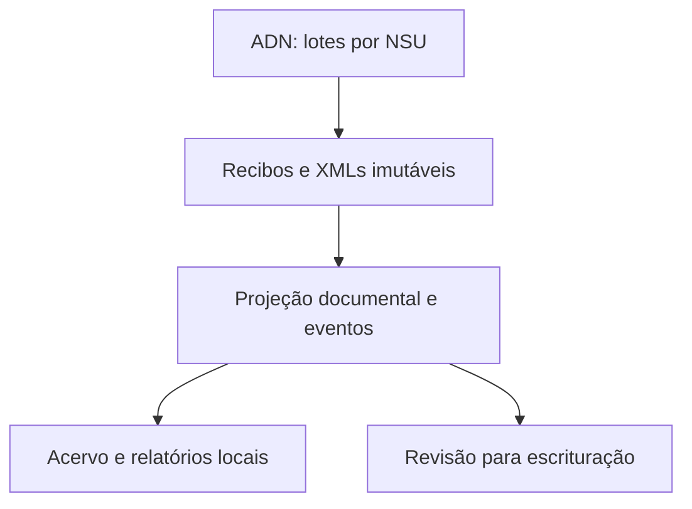

> Continuação implementada: [automação NF-e/NFS-e por empresa, intervalo padrão de 24h](RECEPCAO_AUTOMATICA.md). A PR86 foi ampliada com worker durável e cadastro de agendamentos; índice fiscal e relatórios completos seguem planejados. As referências abaixo descrevem a análise inicial e o plano completo.

# Implementação da recepção ADN NFS-e e relatórios gerenciais no Escritura

Data: 18/11/2026. Destino: `codisplanfiscalai/escritura-integrada`, branch `develop`.
Base conferida: **0.9.0-dev.59**, commit `10f56045298aae92fb0b26654f468db32fb9e9f9`.
O ZIP enviado foi comparado com a árvore desse commit: **757 arquivos idênticos**, sem arquivos ausentes ou divergentes. Não foi usado um pacote antigo para substituir a aplicação.

**Decisão:** evoluir os serviços Python/FastAPI, o cofre A1, os arquivos imutáveis, o RBAC e a interface Vue existentes. O módulo Perfex é referência de regras e regressões; não é dependência do Escritura. Este documento especifica a implementação completa em incrementos. A PR ampliada entrega as correções da seção 17 e o agendamento durável descrito em RECEPCAO_AUTOMATICA.md. Índice/projeção fiscal e novos relatórios continuam planejados.

## 1. Resultado esperado e limites

Uma solicitação deve coletar o histórico disponibilizado ao contribuinte ou atualizar o acervo para consultar um período. A coleta continua por lotes, sobrevive ao fechamento da tela e à reinicialização do processo, retoma o NSU confirmado, preserva documentos/eventos e alimenta relatórios locais de serviços prestados e tomados.

Receber XML não é emitir, manifestar, cancelar por solicitação, reconhecer crédito tributário ou escriturar. A escrituração exige o fluxo próprio de revisão, permissões e competência aberta. Não implantar criação automática de faturas/títulos, emissão ou recálculo tributário junto com esta frente.

O histórico é aquele que o ADN disponibiliza para a inscrição e autorização utilizadas. Não prometer todos os documentos visíveis no portal Web, determinada retenção ou recuperação anterior à sequência disponível sem comprovação do contrato. Não aplicar corte fixo em 2024 e não usar a data da nota para decidir que a distribuição acabou.

## 2. O que existe hoje e o que falta

| Componente atual | Situação verificada | Ação |
| --- | --- | --- |
| `app/reception.py` | Endpoints fixos; GET contribuinte por NSU; `lote=true`; int64 decimal independente do NSU NF-e | Preservar contratos separados |
| `app/reception_credentials.py`, `reception_vault.py`, `reception_native.py` | Cofre por empresa/ambiente, identidade A1, mesma raiz/procuração; backend macOS nativo | Reutilizar; não recadastrar nem mudar criptografia |
| `app/reception_transport.py` | mTLS, hostname/cadeia, limites, sem redirect, uma tentativa | Preservar; evoluir leitura completa de Retry-After com paridade nativa |
| `app/reception_adn.py` | Envelope JSON, GZip/XML seguro, ausência explícita, NSU exato, data auxiliar recuperável | Preservar originais e ampliar variantes por testes |
| `app/reception_service.py` | Reserva, idempotência, recibos, XMLs e cursor na mesma transação | Tornar núcleo também do worker |
| `app/file_store.py` | BLOB canônico em `stored_files`; diretórios regeneráveis por hash | Não criar outro acervo de arquivos |
| `app/reception_workspace.py`, `reception_archive.py` | Acervo/versionamento reconstruídos sobre recibos; paginação local | Substituir progressivamente a reconstrução integral por índice derivado |
| `frontend/src/lib/reception.js` | Loop de lotes enquanto a view está aberta | Migrar orquestração para fila persistente no servidor |
| `ReceptionPanel.vue`, `NfseNationalView.vue` | Consulta, acervo, recibos, versões, CSV | Acrescentar execução, filtros fiscais e relatórios sem outra aplicação |
| `app/permissions.py` e `access.py` | Usuários/grupos, empresa e negação/concessão | Expandir catálogo existente, sem ACL paralela |
| `app/api.py` | Lifespan já administra tarefas de integração/limpeza; auditor e backup têm workers | Integrar ciclo de vida da recepção no mesmo processo |
| `app/report_exports.py`, `report_tables.py`, relatórios fiscais | Exportação e modelos de relatório existentes | Reutilizar apresentação e formatos, com fonte NFS-e própria |

O CSV atual descreve documentos/recepções, mas não apura valores de serviços, ISS, retenções ou situação fiscal por eventos. Na base originalmente analisada, `automation_available` era falsa e o histórico da UI não era uma fila durável. A continuação acrescentou agendamento persistente por empresa/serviço e habilitou essa capacidade, sem substituir os recibos canônicos.

O runtime operacional desta base usa SQLite. `app/postgres_backend.py` declara infraestrutura preparatória ainda não conectada a `create_app`. **Não tornar a entrega dependente de migrar para PostgreSQL, MySQL, Redis, RabbitMQ, MinIO, Celery ou de instalar serviço Windows.** O uso desses componentes, se desejado em outra frente, precisa de integração e homologação próprias.

## 3. Contratos oficiais, autenticação e ambientes

| Finalidade | Produção | Produção restrita |
| --- | --- | --- |
| Base ADN contribuinte | `https://adn.nfse.gov.br/contribuintes` | `https://adn.producaorestrita.nfse.gov.br/contribuintes` |
| Documentação contribuinte | `/docs/index.html` na base | `/docs/index.html` na base |
| Coleta por sequência | `GET /DFe/{NSU}?lote=true` relativo à base | Mesmo contrato do adaptador, ambiente separado |
| Eventos por chave | `GET /NFSe/{ChaveAcesso}/Eventos`, conforme manual contribuinte vigente | Habilitar somente após validar o contrato do ambiente |

Os caminhos oficiais acima não são rotas novas do Escritura. Não trocar a API contribuinte por API municipal, SEFIN ou consulta pública para contornar um erro. A nova rota de eventos ainda não está autorizada no transporte do Escritura: exige incremento específico, allowlist equivalente no helper nativo e testes antes de ser usada.

A autenticação funcional atual é A1/mTLS. Não apresentar login do portal ou armazenamento de usuário/senha como autenticação da API. CPF/A3 e consulta ADN com CNPJ alfanumérico permanecem fora da cobertura atual até validação específica; preservar suporte alfanumérico que já existe nos cadastros e nos XMLs.

O identificador de coleta deve ser `(company_id, provider, environment, inscrição completa consultada)`. Duas filiais da mesma raiz mantêm cursores distintos. Certificado de mesma raiz pode ser usado conforme o contrato, sem transformar a raiz na identidade da empresa. Outra raiz depende de procuração efetivamente aceita pelo serviço; o checkbox local não concede procuração.

Valores de conexão, URLs e identidade não vêm livremente do cliente HTTP. O serviço resolve empresa, configuração e credencial autorizadas no servidor. O worker revalida essas informações e o usuário que iniciou a execução antes de cada lote.

## 4. O aprendizado do módulo NFS-e Nacional

A correção 0.8.9 foi validada no Perfex com consulta autenticada: um evento histórico usava `infEvento/nDFe`; o leitor só aceitava o nome atual `nDFSe`. O ADN devolvia HTTP 200 com 50 documentos e o lote inteiro era interrompido. Aceitar exatamente um dos dois campos oficiais, sem modificar o XML, permitiu concluir a sequência. Isso demonstra a necessidade de testes com leiautes históricos e lotes mistos, não uma restrição do ADN ao ano de 2024.

No Escritura, eventos já são arquivados sem efeito fiscal automático. **Não há a mesma leitura obrigatória de `nDFSe` nesse fluxo e não se deve afirmar que o mesmo defeito foi reproduzido aqui.** A compatibilidade deve existir quando o projetor fiscal de eventos for acrescentado.

Não transportar classes PHP, migrations do Perfex, dependências vendor, identidade Multiempresa ou chaves criptográficas para Python. Transportar os contratos, invariantes, cenários de falha e critérios de aceitação. Os dados reais e credenciais da validação do Perfex não devem entrar no repositório ou virar fixtures.

## 5. Separar coleta, projeção e escrituração

**Cursor de transporte:** avança somente depois de validar o envelope, os NSUs e a integridade de todos os XMLs e persistir atomicamente o retorno e cada original. Não avança por contagem, data ou quantidade exibida na tela. Um pacote faltante, GZip inválido, erro de persistência ou resposta ambígua mantém o cursor anterior e o retorno disponível para diagnóstico.

**Checkpoint de projeção:** identifica até qual versão do leitor cada original foi interpretado. Um evento de tipo conhecido ainda não interpretado pode continuar preservado como pendência, sem alterar o estado fiscal nem impedir o uso dos demais originais já arquivados. Isso não é pular documentos: o XML fica durável e reprocessável. Tipo de envelope não reconhecido continua sujeito ao contrato estrito existente até ampliação testada.

**Escrituração:** não usa o NSU ou a data de recepção como competência. Seleciona versão, emissão e competência de escrituração por revisão autorizada. O acervo pode receber notas de períodos fechados; isso não autoriza alterar lançamentos fechados. Eventos posteriores geram divergência/pendência de revisão, sem reescrever escrituração ou relatórios históricos já emitidos.

## 6. Persistência incremental proposta

Nomes abaixo são **proposta de modelo**, não tabelas já criadas pela PR. Usar a conexão e as migrações nativas existentes, com chaves estrangeiras e índices; não criar outro banco operacional.

| Estrutura | Conteúdo e unicidade |
| --- | --- |
| `reception_sync_runs` | Empresa, inscrição, serviço, ambiente, modo, período solicitado, usuário, revisão de configuração, estado, início, heartbeat, próxima tentativa, contadores, motivo; no máximo uma execução ativa por identidade de coleta |
| `reception_sync_attempts` | Run, cursor solicitado, número da tentativa, chave idempotente, recibo canônico, resultado, duração; chave idempotente única por empresa |
| `nfse_archive_documents` | Empresa, inscrição, ambiente e chave nacional; referência ao original/versão selecionada, participantes, papéis, datas, valores declarados, situação e qualidade; unicidade por identidade completa |
| `nfse_archive_versions` | Documento, hash, file_id, primeira/última origem, versão do parser, conflito; hash único por documento, sem sobrescrita |
| `nfse_archive_occurrences` | Recibo + NSU + hash e versão; preserva reconsulta/reentrega sem aumentar quantidade de notas |
| `nfse_archive_events` | Chave, EVT, tipo, sequência, registro e hash; XML original, evidência e efeito validado; conflitos em revisão |
| `nfse_projection_checkpoints` | Identidade/versão do leitor, última origem processada, falhas por documento e tentativa; retomável |
| `nfse_report_snapshots` | Opcional para exportações auditáveis: filtros, data de corte, versão do leitor, hashes/versões selecionadas, totais e arquivo gerado |

`operations` nos namespaces `fiscal-reception-state-v1` e `fiscal-reception-run-v1` e `stored_files` continuam canônicos. Não duplicar o cursor em uma nova tabela independente. O run referencia o estado existente; contadores derivados de recibos confirmados evitam perda/dobra após crash.

Índices mínimos: execução por estado/próxima tentativa; documentos por empresa/ambiente/competência/chave; emissão; participante; situação; eventos por chave/tipo; versões e ocorrências por documento/hash/recibo. NSU continua string decimal exata; nunca float/Number JS. Dinheiro deve ser inteiro de centavos ou Decimal decimal serializado como string; percentuais são decimais separados, sem arredondar no parser.

Inicialmente, participantes, competência e valores ausentes ficam **nulos/pendentes**, não zero. Guardar caminho XML e versão do leitor para cada fato derivado relevante. Não deduzir ISS, líquido, retenção ou valor de tributo de uma diferença entre outros campos.

## 7. Worker durável e retomada

Implementar `ReceptionSyncService` sobre `ReceptionService`, não um segundo cliente ADN. A API apenas cria/retoma a execução e retorna 202; um loop no lifespan usa `asyncio.to_thread` para trabalho bloqueante, com fechamento cooperativo. Docker e aplicativo tray usam o mesmo processo. Não executar trabalho longo em `BackgroundTasks` sem fila persistente.

Estados: `pending`, `running`, `waiting`, `blocked`, `failed`, `paused`, `completed`, `cancelled`. Exibir motivo, última atividade, tentativa e próxima execução. `completed` só depois de ausência fiscal explícita. `paused` para solicitação humana; cancelar/pausar não apaga acervo nem desfaz lote confirmado.

Algoritmo por lote:

1. Selecionar execução vencida por identidade de coleta e adquirir lease persistente com token/geração. Transação curta; não segurar lock SQL durante HTTP.
2. Revalidar usuário ativo, acesso à empresa, permissão de consulta, ambiente, inscrição completa, revisão da configuração e disponibilidade do A1. Mudança bloqueia com motivo, sem escolher outra credencial/empresa silenciosamente.
3. Consultar o estado canônico. Se `next_allowed_at` está no futuro, agendar e sair sem rede. Não aplicar uma espera fixa entre lotes positivos.
4. Reservar tentativa com chave idempotente derivada de run + cursor + tentativa. O worker não deve usar sessão/CSRF de navegador nem criar um novo administrador.
5. Chamar o mesmo `ReceptionService.query` e persistir recibo/retorno/arquivos/cursor por seu fluxo transacional.
6. Se lote positivo válido avançou: atualizar contadores pelo recibo confirmado e enfileirar projeção. Prosseguir em fatia de trabalho limitada, cedendo a outras empresas entre fatias; esse limite não encerra o histórico.
7. Respeitar `Retry-After` também no lote positivo. Ao fim explícito, concluir o run e aplicar a pausa de esgotamento. Distinguir ausência de documentos de indisponibilidade/recusa.
8. Em erro temporário, registrar diagnóstico sanitizado e agendar backoff com teto/jitter e máximo de tentativas. Tempo de espera nunca significa conclusão ou perda de cursor.
9. Em timeout/crash, reconciliar recibo da tentativa anterior: se confirmou, contabilizar uma vez; se está em andamento/incerto, preservar lease e não criar nova tentativa concorrente. Depois da expiração/revisão, retomar GET do cursor confirmado sob política explícita. Não executar emissão como recuperação.
10. Renovar heartbeat em trabalho longo. Token de geração impede que worker antigo confirme após lease tomado por outro. Revalidar identidade/permissão no commit, como a base já faz.

Uma execução concluída não é um agendamento recorrente. Se houver monitoramento periódico, ele deve ter configuração própria, inicialmente desabilitada, por empresa/ambiente: um novo run incremental só é criado quando vencerem a frequência configurada e a pausa do serviço. Nunca reabrir indefinidamente um run concluído nem prometer nova consulta automática sem essa política habilitada. Exibir “concluído” e “próxima atualização agendada” como informações distintas.

Duas instâncias com a mesma base devem disputar a mesma lease. Bases independentes e outros aplicativos não são coordenados automaticamente: preferir um coletor autorizado por inscrição/ambiente e compartilhar o acervo por integração acordada. Não presumir que o Escritura controla o coletor Perfex ou outro fornecedor.

## 8. Histórico completo e período

A distribuição contribuinte existente usa NSU, sem filtro remoto por data neste adaptador. No modo período, **coletar até o esgotamento permitido e aplicar filtro local** sobre emissão ou competência escolhida. Não interromper quando um lote estiver fora do período: NSU segue recepção no ADN, não ordem fiscal de emissão.

Solicitações de outro período compartilham a mesma sequência. Atualizar seleção ou criar uma visão local não pode zerar o cursor, apagar fila ou gerar HTTP 409 apenas por diferença de filtro. Manter proteção para worker realmente concorrente.

Na interface, separar:

- Emissão do XML; competência fiscal declarada; data/período de recepção; competência escolhida para escrituração.
- Modo da coleta e filtros do relatório. O exercício global pode restringir a escrituração, mas não deve esconder histórico externo sem informar a base do filtro.
- Fim da página local e fim da distribuição remota. Mostrar “50 de N documentos locais” e “X lotes processados”; não inventar percentual concluído sem total remoto.

A base atual filtra `year` pelo `reference_period` de recepção em `reception_archive.matches`. Não reinterpretar esse campo como ano de emissão na migração. Acrescentar filtros explícitos de data base e de todo o acervo, preservando o histórico do recibo e os testes de escopo.

## 9. Leitor fiscal e eventos históricos

Criar leitor NFS-e de fatos declarados, reutilizando `_xml_tree` e limites do leitor atual. Exigir namespace nacional, grupos únicos, caminhos diretos, tipos/tamanhos exatos e correlação entre chave do envelope, `infNFSe/@Id`, ambiente e inscrição. Não usar busca recursiva genérica que escolha o primeiro campo de grupo estranho.

Mapear versão do leiaute; testar versões históricas e atuais. Os esquemas antigos e atuais coexistem no acervo. Preservar bytes e assinatura do XML, sem renomear tags no original.

O parser de eventos deve aceitar exatamente um filho direto `nDFe` **ou** `nDFSe` no namespace nacional; ausência, duplicidade, coexistência ou valor inválido ficam como pendência de projeção. Pedidos `pedRegEvento` sozinhos não confirmam evento registrado. Validar EVT, chave, tipo, sequência, ambiente, datas, pedido correlacionado e estrutura da assinatura. Presença da assinatura não equivale a validar cadeia ICP-Brasil; registrar níveis de verificação separadamente.

No incremento de efeito fiscal, documentar cada tipo aceito com os leiautes oficiais. Referência do módulo: 101101, 105102, 105104 quando deferido e 305101 são candidatos de cancelamento; conferir códigos/motivos do leiaute antes de portar. Solicitação, indeferimento, manifestação ou bloqueio não são cancelamento. Evento desconhecido não autoriza alteração da situação.

Eventos antes da nota ficam vinculados à chave e são aplicados quando a versão documental chegar. Reentrega idêntica não altera contagens; mesmo identificador com bytes divergentes fica em conflito. Substituição vincula notas anterior/nova e preserva ambos os XMLs; não somar ambas como receita vigente nem declarar cadeia concluída se faltar documento.

A situação exibida deve distinguir “XML nacional recebido”, “estrutura conferida”, “evento correlacionado”, “assinatura verificada” e “confirmação externa”. A relação com escrituração é uma informação separada.

## 10. Relatórios gerenciais e regras de totalização

Os relatórios consultam o índice local, sem carregar certificado ou chamar o ADN. Usar filtros idênticos para grid, totais e exportação, em snapshot consistente. Valores são declarados no XML; não constituem apuração de ISS, DAS, CBS ou IBS.

| Relatório | Dimensões/filtros | Medidas e ressalvas |
| --- | --- | --- |
| Serviços prestados | Emissão ou competência, cliente, município, serviço, situação, ambiente | Quantidade de notas únicas, valor de serviços, descontos, deduções, base e ISS declarados, líquido quando presente |
| Serviços tomados | Competência/emissão, prestador, município, serviço | Mesmas medidas; separar tomador de mero intermediário |
| Evolução mensal/anual | Competência escolhida e ano comparativo | Série mensal, variação absoluta/% com base zero tratada explicitamente; sem extrapolar meses ausentes |
| Clientes/prestadores | Participante completo, período e direção | Ranking de valores e quantidade, concentração, tíquete médio em notas elegíveis |
| Serviços e municípios | cTribNac/cTribMun/NBS, município de incidência/prestação | Agrupamento sem converter percentual de estimativa IBPT em ISS |
| ISS e retenções declaradas | Período, tipo de retenção, participante | Bases, percentuais e valores efetivamente informados; retenções por tributo separadas; nunca calcular “líquido” por subtração presumida |
| Cancelamentos e substituições | Data do evento e competência da nota separadas | Valores brutos, cancelados e vigentes; encadeamento e pendências; corte temporal explicitado |
| Conciliação com escrituração | Chave, versão e lançamento vinculado | Recebidas sem revisão, pendentes de escrituração, divergência de competência/valor/estado; sem criar lançamento pela consulta |
| Integridade e cobertura | Empresa, ambiente, run, período, qualidade | Lotes, cursor, XMLs faltantes, versões conflitantes, erro de projeção, última atividade; ausência de nota não prova omissão fiscal |
| Consolidado de empresas | Empresas explicitamente selecionadas e autorizadas | Fonte comum do acervo; não somar a mesma nota duas vezes no total global; papéis por empresa conservados |

Regras obrigatórias:

1. Nota única por empresa/ambiente/inscrição/chave, não por NSU ou recibo. Totais documentais não são totais de recepções.
2. Reentrega byte a byte gera origem adicional, não receita adicional. Versões divergentes são preservadas; ficam excluídas dos totais definitivos por padrão até revisão, com quantidade/valor pendente visíveis.
3. Uma empresa simultaneamente prestadora e tomadora aparece nas visões correspondentes; o consolidado geral usa uma nota única. No consolidado multiempresa, usar chave nacional + ambiente para total geral e conservar a visão de cada empresa.
4. Intermediário não é automaticamente tomador. A base atual classifica esse interesse junto às recebidas para consulta; o relatório deve separar os papéis antes de totalizar serviços tomados.
5. Dados ausentes permanecem nulos. Informar cobertura dos valores e pendências; não completar com zero, alíquota fixa ou cálculo presumido.
6. Cancelada não some da listagem: separar bruto, cancelado e vigente. Consultas “na data de corte” consideram apenas eventos conhecidos/confirmados até o corte e registram essa limitação.
7. Percentual do Simples/IBPT não substitui alíquota do ISSQN. Regras de cálculo de emissão não pertencem ao relatório de documentos recebidos.
8. Exportações CSV/XLSX protegem contra fórmulas; PDF traz filtros, data de corte, ambiente, definição dos totais e pendências. Exportar mais de uma página sem repetir consulta por página.
9. Consolidado exige acesso a todas as empresas incluídas e às permissões do relatório. Não executar consultas entre empresas por ID livre ou reutilizar cache sem escopo.

## 11. Permissões por usuário e grupo

Reutilizar `decision/require`, acesso à empresa e precedências de negação existentes. Não atribuir acesso automaticamente a todos os usuários que já importam XML.

Proposta de catálogo, a registrar em migração aditiva/configuração de permissões:

| Rotina proposta | Ações |
| --- | --- |
| `fiscal.nfse.archive` | read, export |
| `fiscal.nfse.sync` | read, create, edit (retomar/pausar) |
| `fiscal.nfse.review` | read, edit |
| `fiscal.nfse.report.issued` | read, export, print |
| `fiscal.nfse.report.received` | read, export, print |
| `fiscal.nfse.report.taxes` | read, export, print |
| `fiscal.nfse.report.events` | read, export, print |
| `fiscal.nfse.report.reconciliation` | read, export, print |
| `fiscal.nfse.report.consolidated` | read, export, print + empresa por empresa |

Compatibilidade: manter rotas e permissões antigas funcionais durante transição; as rotas novas exigem o catálogo novo, sem bypass por URL. Usar usuários e grupos do Escritura; não criar credenciais de usuário em banco paralelo. A1 continua sob gestão de empresa autorizada. Revogação deve interromper o worker e a exportação em progresso antes de nova leitura/transmissão.

## 12. API interna e telas propostas

Rotas seguintes são **propostas de API interna**, não endpoints do serviço nacional e não implementadas pela PR corretiva:

| Método/rota relativa à empresa | Comportamento |
| --- | --- |
| `POST /reception/nfse_adn/sync-runs` | Criar/retomar coleta idempotente; retornar 202 + id |
| `GET /reception/nfse_adn/sync-runs/{id}` | Estado/progresso somente leitura, sem chamada fiscal |
| `POST /reception/nfse_adn/sync-runs/{id}/pause` | Parar após lote atual; não apagar arquivos |
| `POST /reception/nfse_adn/sync-runs/{id}/resume` | Retomar cursor e pausa já confirmados |
| `GET /nfse-archive/documents` | Paginação SQL, busca, filtros de datas/papéis/situação/qualidade |
| `GET /nfse-archive/documents/{id}/events` | Eventos locais, evidências e pendências |
| `GET /nfse-reports/{kind}` | Resultado gerencial local autorizado |
| `POST /nfse-reports/{kind}/exports` | Exportação longa como job com filtros/corte congelados |
| `GET /nfse-reports/exports/{id}` | Estado e download reautorizado |

A base `/api/companies/{cid}` mantém sessão, CSRF nos comandos e contexto canônico. O worker usa contexto de serviço limitado ao usuário/empresa autorizados, sem sessão de navegador. Um ID de run/exportação de outra empresa retorna 404/403 sem revelar seu conteúdo.

Na mesma view NFS-e, usar guias **Emitidas**, **Recebidas**, **Intermediação**, **Execuções**, **Eventos/pendências** e **Relatórios**, conforme permissão. Progresso mostra lotes, itens, notas únicas, eventos, falhas, cursor confirmado e próxima tentativa. Não mostrar “histórico completo” só porque o primeiro lote passou.

O nome do prestador pode estar em `infNFSe/emit/xNome`. Usar esse nome apenas quando a inscrição completa coincide com `DPS/prest`; não emprestar razão social de outra filial. Esta correção pontual já integra a PR.

## 13. XML, DANFSe, PDF e pacotes

Manter downloads dos originais por ID/recibo + hash e permissão de exportação. Não receber caminho de disco ou URL arbitrária. Para DANFSe, verificar contrato oficial do endpoint específico antes de habilitar a rota; não deduzir a rota pelo nome da tela Web.

O Escritura pode gerar PDF local a partir do XML quando existir renderizador próprio validado para o leiaute, com indicação de origem local e situação suportada. PDF de NF-e não é renderizador NFS-e. Se o XML não permite confirmar dados, mostrar pendência e manter download do original; não produzir DANFSe aparentemente autorizado com campos inventados.

Pacote por período: seleção de documentos únicos, XMLs originais, eventos e índice CSV/JSON com hashes, versões, critérios e data de corte. Arquivo deve conter somente empresas/documentos autorizados, com nome de arquivo seguro, preparação em área privada e expiração do download conforme política existente. Geração repetida com o mesmo snapshot não altera originais.

## 14. Implantação, migrações e recuperação

1. Backup consistente do banco e do cofre A1 pelo mecanismo existente. Confirmar que o backup inclui `stored_files`; testar restauração com material sintético antes do rollout.
2. Criar estruturas/índices aditivos, com checkpoints e retomada. Não editar migrações já aplicadas, renomear scopes existentes nem recalcular chaves criptográficas.
3. Executar backfill do índice a partir de recibos e XMLs locais, em blocos limitados. Gravar versão do parser e cursor do backfill na mesma transação; reexecução deve ser idempotente.
4. Original removido por política autorizada/tombstone vira pendência explícita de integridade/cobertura. Não recriar por suposição nem declarar revalidação concluída. Definir política própria de retenção de acervo fiscal antes de reutilizar limpeza de lotes.
5. Ativar índice em modo comparação, confrontando contagem, chaves e amostras de campos com a projeção atual. Só depois ativar leitura indexada.
6. Habilitar worker para uma empresa/ambiente piloto, sem disparar consultas em todas as empresas ao atualizar a aplicação. Usuário autorizado escolhe coleta e ambientes; iniciar histórico é ação explícita.
7. Testar desligamento do tray, reinício Docker e disputa de dois processos. Recuperação consulta o mesmo recibo/cursor; nunca reprovisiona empresas ou recadastra A1.
8. Ativar projeção fiscal, relatórios e permissões por incremento. Manter versão anterior do parser/snapshots para explicar alterações de projeção.
9. Rollback desabilita o worker/novas views, preservando tabelas aditivas, recibos, cursores e originais. Se houver divergência entre índice e original, reprocessar o índice; não substituir o original.

Rede: certificados e inscrições são enviados apenas à API oficial configurada. Logs não guardam PFX, senha, chave privada, token, XML integral ou dados de terceiros. Telemetria registra run/attempt, etapa, status/código, durações, bytes, contagens e hashes. Não colocar dados reais em artifacts de CI, PR, fixtures ou webhooks automáticos.

Manter o empacotamento/Compose/tray e fluxo SemVer da `develop`. A PR corretiva não altera VERSION, lockfiles, workflows, release ou deploy; o pipeline de release existente administra a próxima versão. Não dar merge ou publicar produção automaticamente como parte da criação da PR.

## 15. Plano de entrega e critérios de saída

| Incremento | Implementação | Critério verificável |
| --- | --- | --- |
| **P0 — Correção de base (esta PR)** | Pausa somente após ausência explícita; Retry-After em lote positivo; fallback de nome do emitente com identidade coincidente; testes e este plano | Regressões falham antes/passam depois; cursor/arquivos/RBAC preservados |
| **P1 — Coleta durável (PR ampliada)** | Runs/attempts, worker lifespan, lease/token, retomada, UI de execução, seleção de período/histórico | Uma solicitação percorre vários lotes sem view aberta, até E2220; restart retoma e duas instâncias não duplicam tentativa |
| **P2 — Índice e fatos NFS-e** | Migração/backfill, parser versionado, datas/participantes/valores, namespace/correlação, ambas as tags de registro de evento | Mais de um ano consultável; metadados corretos; consulta da primeira página não lê todos os XMLs |
| **P3 — Eventos e situação** | Projeção de eventos, conflitos, evento antes da nota, substituição, atualização por chave autorizada | Pedido não cancela; cancelamento só com evento confirmado; conflito nunca sobrescreve original/lançamento |
| **P4 — Gerencial e arquivos** | Matriz de relatórios, permissões, snapshots, CSV/XLSX/PDF, DANFSe/pacotes validados | Totais exatos reconciliáveis com XML, sem duplicidade de recebimentos ou papéis; exportação e grid usam os mesmos filtros |
| **P5 — Escrituração e rollout** | Vínculo com prévia/revisão existente, conciliação, piloto, recuperação e documentação operacional | Recepção não lança sozinha; período fechado protegido; rollback/restore demonstrados |

Cada incremento deve ter PR pequena sobre a `develop` corrente. P2 pode preparar o índice enquanto P1 evolui, mas nenhum relatório de situação vigente deve ser anunciado completo antes de P3. Não consolidar todos os incrementos num refactor que substitua os serviços atuais.

## 16. Matriz de validação para a implementação completa

| Grupo | Cenários obrigatórios |
| --- | --- |
| Contrato/mTLS | Produção/restrita, A1 próprio/mesma raiz/procuração, E2245, certificado errado/vencido, sem senha de portal como API, sem fallback de host/ambiente |
| Lotes | 1, 2 e muitos lotes; datas 2024/2025/2026 intercaladas; lote positivo de 1 ou 50 itens continua; NSU acima de 2^53 e até int64; vazio fiscal explícito versus 404 genérico |
| Pausas | Positivo sem Retry-After não ganha espera fixa; com Retry-After respeita prazo; 429/503; E2220 aplica pausa de esgotamento; nova seleção não zera pausa |
| Persistência | Falha no segundo XML, disco/SQL, crash antes/depois do commit, read-only, originais removidos, hash divergente, recibo anterior incerto |
| Concorrência | Duas instâncias e consultas manual/worker; lease expirada e worker antigo; ajuste de NSU e troca de credencial enquanto trabalha |
| Eventos/leiaute | nDFe/nDFSe; ausência/duplicidade/namespace errado; PRE antigo/novo; pedido sem evento, deferimento/indeferimento, sequência/chave/ambiente errados, evento antes da nota, substituição incompleta |
| Fiscal/datas | Emissão, competência, recepção e escrituração distintas; valores Decimal e ausentes; ISS/Simples/IBPT separados; cancelada não soma como vigente |
| Relatórios | Reentrega, versões divergentes, nota both, intermediário, consolidação multiempresa, corte temporal, CSV/XLSX seguro, exportação de todas as páginas |
| RBAC | Usuário/grupo, negar por empresa/relatório, revogação durante execução, download/exportação indiretos e tentativa por ID de outra empresa |
| Operação | Tela fechada, restart tray/Docker, migração interrompida e retomada, backfill idempotente, backup/restauração, rollback sem apagar acervo |
| Desempenho | Medir 5 mil, 50 mil e 500 mil documentos sintéticos; SQL paginado e índices; exportação em blocos; estabelecer metas p95 e memória no ambiente de implantação, sem alegar benchmark não executado |

Homologação fiscal remota no Escritura é etapa própria: certificado/autorização apropriados, uma empresa piloto e comparação com acervo do serviço. A validação real do módulo Perfex não substitui esse teste nem autoriza transportar suas credenciais. Testes locais e CI usam apenas dados sintéticos.

## 17. Escopo e evidência da PR corretiva

Correções e continuação implementadas, sem migração de banco:

- `ReceptionService._interpret`: ausência ADN explicitamente reconhecida aplica `max(3600, Retry-After)`; resposta positiva preserva Retry-After; nenhuma pausa artificial é adicionada aos demais lotes positivos.
- `reception_metadata.classify`: nome em `infNFSe/emit/xNome` é aproveitado somente quando existe um único emitente e a identidade completa coincide com o prestador; nome existente em prestador mantém prioridade.
- Testes de regressão cobrem ausência 200/404 reconhecida, repetição idempotente, pausa maior que uma hora, positivo com/sem pausa e emitente de outra filial/ambíguo/namespace estranho.
- Worker durável para NF-e e NFS-e no lifespan, agendamento independente por empresa com padrão de 24h, retomada/replay, configuração e situação na tela da empresa. Implementação e cobertura em [RECEPCAO_AUTOMATICA.md](RECEPCAO_AUTOMATICA.md).
- Mantidos endpoints fiscais, helper nativo, autenticação, criptografia, arquivos/cursor transacionais, dados/migrações, loop manual e APIs existentes.

Antes da alteração, a suíte inicial de seis testes reproduziu falhas de ausência sem pausa, Retry-After ignorado e nome nacional ausente. Os casos negativos de identidade já permaneciam restritos. Foi acrescentado um sétimo teste para o lote misto com eventos históricos `nDFe` e atuais `nDFSe`, comprovando preservação literal dos XMLs e avanço do cursor sem efeitos de escrituração/cancelamento. Os sete testes passaram após a correção. As contagens ampliadas e limitações são registradas no resumo da PR, após a execução dos testes.

**Não entregue por esta PR:** índice/backfill fiscal, parser fiscal completo/eventos, novos relatórios/PDF, novos grants ou homologação remota. O worker e o agendamento agora são funcionais; os demais incrementos permanecem planejados. A automação começa desabilitada e só consulta após habilitação explícita.

## 18. Fontes e decisões de contrato

Referências consultadas em 18/11/2026:

1. [Relação oficial de APIs e ambientes](https://www.gov.br/nfse/pt-br/biblioteca/documentacao-tecnica/apis-prod-restrita-e-producao): separação contribuinte/município/DANFSe/SEFIN e hosts por ambiente.
2. [Manual contribuinte ADN v1.1 de 03/11/2026](https://www.gov.br/nfse/pt-br/biblioteca/documentacao-tecnica/documentacao-atual/manual-municipios-apis-adn-sistema-nacional-nfs-e-v1-1-20261103.pdf): apesar do nome físico do arquivo conter “municipios”, título e conteúdo são do guia contribuinte; inscrição completa, mesma raiz, procuração, TipoConsulta, GET por NSU e eventos por chave, E2220 e erros de autenticação/autorização.
3. [Documentação atual e esquemas](https://www.gov.br/nfse/pt-br/biblioteca/documentacao-tecnica/documentacao-atual): usar versões e vigências próprias, sem transformar o documento histórico.
4. [Esquemas históricos](https://www.gov.br/nfse/pt-br/biblioteca/documentacao-tecnica/leiaute-e-esquemas-antigos/xsd_pl_nfse_1-00-producao.zip/view): `tiposEventos_v1.00.xsd` usa `nDFe`; esquemas posteriores usam `nDFSe`.
5. [FAQ oficial v1.3 de 06/11/2026, seção 19.2](https://www.gov.br/nfse/pt-br/perguntas-frequentes/perguntas-frequentes-nfs-e-v1-3-20261106.pdf/@@download/file): ordem por recepção e espera de esgotamento no contexto de distribuição descrito ali. Não transferir para o contribuinte limites de API municipal/NF-e nem inferir maxNSU ausente no envelope contribuinte.
6. Implementação validada NFS-e Nacional 0.8.9: evidência operacional de compatibilidade histórica e retomada, não substituto da documentação oficial nem homologação do cliente Python.

A pausa de uma hora do P0 é uma **política operacional conservadora após esgotamento explícito**, alinhada à referência implementada, sem transformar a FAQ municipal em prova de um campo maxNSU no contribuinte. O manual contribuinte v1.1 não especifica, nessa descrição resumida, todos os limites de consumo ou retenção. Não aplicar a pausa a páginas positivas normais. Rever políticas com o contrato oficial específico quando houver atualização.
