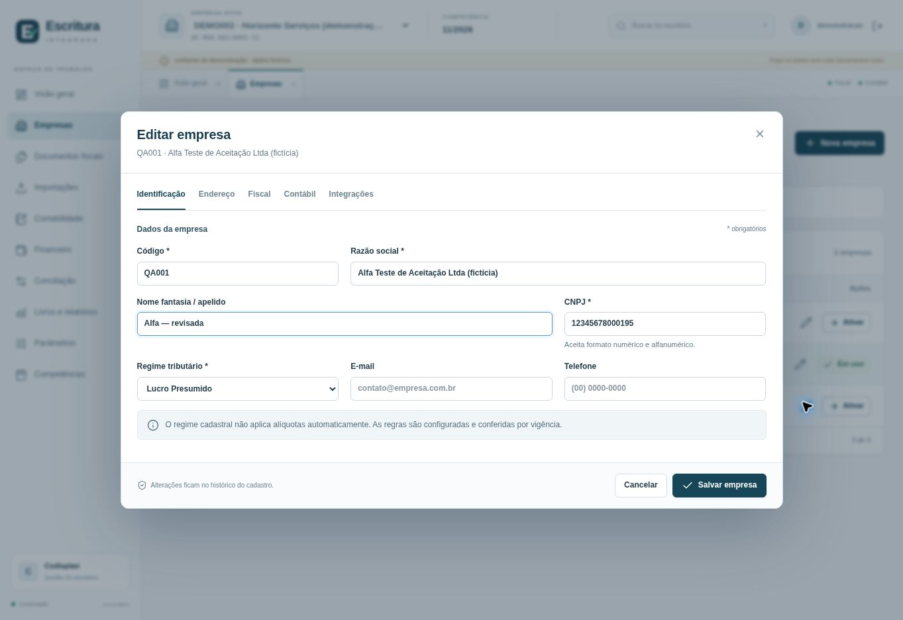
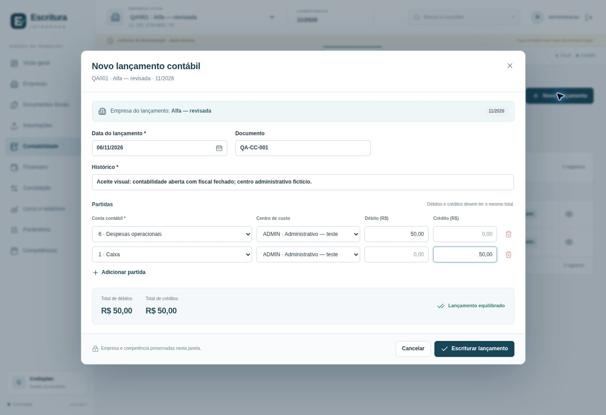
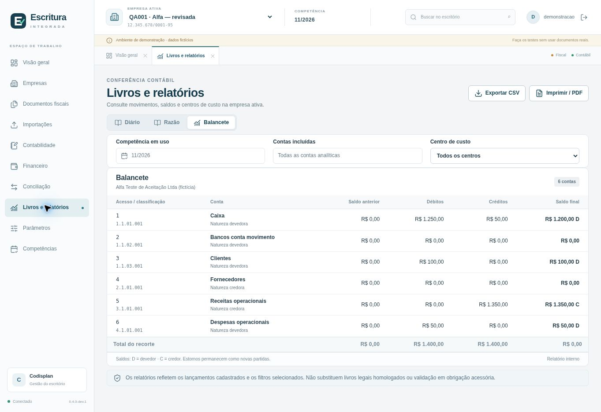

> Documento histórico da implementação inicial. Consulte o [diagnóstico 0.5](DIAGNOSTICO_EXPANSAO_0_5.md), a [operação](OPERACAO_0_5.md) e a [validação atual](VALIDACAO_0_5.md).

# Validação funcional inicial — 0.4.0-dev.1

Este é o registro histórico da avaliação anterior à integração CI/CD. As distribuições posteriores possuem seus próprios runs, resultados e manifestos de release. As pendências de plataforma aqui registradas descrevem aquela etapa; consulte o run da versão desejada para o estado de seu binário e suas imagens.

**Execução registrada em 6–7 de novembro de 2026.** Dados exclusivamente fictícios, base separada de demonstração e interface Chrome em viewport de aproximadamente 1363 × 936 px. Este registro distingue o que foi observado na interface, o que foi exercitado por testes e o que permanece pendente.

## 1. Resultado técnico

| Verificação | Resultado | Alcance |
|---|---:|---|
| API e domínio | 19 testes aprovados | Contexto, propriedade dos registros, concorrência, transações, regras, livros e bloqueios |
| Leitores de arquivos | 31 testes aprovados | Fixtures sintéticas de XML, SPED parcial, bancários e arquivos compactados, com diagnósticos e limites |
| Controlador local | 3 testes aprovados | Início, parada e ciclo do servidor local; sem interface Qt |
| Entrada de datas | 5 testes aprovados | Formato brasileiro, calendário gregoriano, limites e conversão para ISO |
| Frontend Vue/Vite | Build aprovado | Compilação da interface; não equivale a aceite visual |
| Python | Compilação aprovada | Verificação de sintaxe dos módulos, scripts e testes |

**Total daquela rodada: 58 testes aprovados, sem falhas.** Comandos, horários, versões, logs e hashes foram entregues no pacote de análise inicial. Os resultados posteriores de CI e distribuição são publicados nos runs e artefatos do GitHub Actions.

## 2. Percursos realmente observados na interface

| Percurso | Resultado observado |
|---|---|
| Cadastro de empresa | QA001, Alfa Teste de Aceitação Ltda (fictícia), criada pelo modal e disponível na lista; salvar preservou a empresa que já estava ativa |
| Editar A com B ativa | Horizonte permaneceu ativa enquanto Alfa foi editada; o nome fantasia de Alfa passou a `Alfa — revisada` |
| Ativação explícita | Alfa selecionada no cabeçalho; código, nome e competência reapareceram no modal contábil |
| Proteção durante edição | Seletores de empresa e competência ficaram desabilitados enquanto o modal de lançamento estava aberto |
| Equilíbrio das partidas | Apenas débito manteve a escrituração desabilitada; crédito correspondente habilitou a ação |
| Descarte de edição | ESC abriu confirmação; escolher Voltar preservou os campos preenchidos |
| Gravação no destino correto | `QA001-L001`, R$ 1.250,00, apareceu em Alfa, não apareceu em Horizonte e voltou a aparecer ao retornar a Alfa; persistiu após recarregar a aplicação |
| Datas brasileiras | Campos de data corrigidos para DD/MM/AAAA; `06/11/2026` observado no novo lançamento e no título financeiro |
| Baixa parcial | Título `QA-FIN-001`, de R$ 100,00; tentativa de baixa de R$ 150,00 recusada; baixa de R$ 40,00 deixou saldo de R$ 60,00 e situação Parcial |
| Conciliação explícita | Saída bancária de R$ 450,00 vinculada ao título DEMO-002 após seleção e justificativa; responsável e motivo visíveis |
| Vínculo não liquida título | Após a conciliação, DEMO-002 continuou com valor original e saldo de R$ 450,00, situação Em aberto |
| Fiscal e contábil integrados | Documento manual fictício `QA-DOC-001`, modelo 99, R$ 100,00: Pendente → Conferido → Escriturado; integração gerou débito em Clientes e crédito em Receitas operacionais escolhidos manualmente |
| Fechamento independente | Fiscal de Alfa em 11/2026 fechado com motivo e responsável; contábil permaneceu aberto |
| Contabilidade após fechar fiscal | Novo lançamento `QA-CC-001`, R$ 50,00, salvo com o fiscal fechado: débito em Despesas operacionais e crédito em Caixa, ambos no centro ADMIN |
| Diário por centro | Filtro ADMIN apresentou somente as duas partidas de QA-CC-001, totalizando R$ 50,00 em cada lado |
| Balancete da empresa | Sem filtro de centro: débitos e créditos de R$ 1.400,00; Caixa R$ 1.200,00 D, Clientes R$ 100,00 D, Receitas R$ 1.350,00 C e Despesas R$ 50,00 D |
| Razão de Caixa | Entrada de R$ 1.250,00 e saída de R$ 50,00, saldo final R$ 1.200,00 D |
| Auditoria | Cadastros, edição, conferência, escrituração e fechamento de Alfa apareceram no histórico da própria empresa |

Quatro capturas representativas estão em `docs/images/`; todos os nomes, documentos e valores usados nesses testes são fictícios. O banco de demonstração, as sessões e os materiais privados de referência não integram o repositório público.

## 3. Correções motivadas pela avaliação visual e funcional

- A data nativa do navegador podia exibir mês/dia enquanto a tabela exibia dia/mês. O componente de entrada agora apresenta DD/MM/AAAA e mantém ISO apenas no contrato interno.
- O cabeçalho de competência passou a mostrar MM/AAAA explicitamente.
- A faixa de guias deixou de apresentar rolagem vertical indevida.
- O painel e a tela de relatórios receberam redução localizada de espaços, preservando o tamanho da fonte.
- O foco inicial de modais passou para o primeiro campo útil. A confirmação de descarte preserva a edição ao voltar.
- O regime de uma empresa nova começa a definir; não é presumido Simples Nacional.
- Na mudança de empresa, listas anteriores são limpas e respostas atrasadas não substituem o contexto atual.
- Percentuais inteiros como 10 e 100 deixaram de ser persistidos em notação exponencial, evitando falha na edição de uma regra. A correção possui teste de regressão.
- Foram corrigidos rótulos técnicos expostos na auditoria, plural de movimento e a geração de identificadores em contextos sem `crypto.randomUUID`.

## 4. O que não foi concluído ou não constitui aprovação

### Importação pela seleção de arquivo

A seleção de `nfe_ficticia.xml` foi observada no navegador. Durante a tentativa de analisar o arquivo, a sessão deixou de estar autenticada e a API respondeu 401. A causa específica dessa perda de sessão não foi determinada. Não houve alteração de cookies, CSRF ou controles de origem para contornar o problema.

Esse percurso visual completo de seleção → prévia → confirmação permanece **não concluído**. Os leitores e a confirmação transacional foram verificados pelos testes da API. Esses resultados não substituem o aceite de importação na interface.

### Plataformas e interface

- Nenhum EXE Windows foi construído ou executado nesta entrega. Tray, janela Qt, preferências, impressão/PDF nativa e empacotamento estão implementados no código e precisam de execução em Windows x64.
- Dockerfile, Compose e workflow GHCR foram conferidos no código; não houve build/execução Docker nem publicação de imagem.
- A responsividade foi implementada em CSS, mas não houve aceite visual em largura móvel ou altura de 720/768 px.
- As telas de Diário, Razão e Balancete foram consultadas. O download CSV e o diálogo final de impressão/PDF não foram exercitados neste percurso visual.
- O bloqueio fiscal com contabilidade aberta foi comprovado na interface. O cenário inverso, contextos antigos em outra aba e rejeição de relações cruzadas foram exercitados nos testes técnicos, não em todos os respectivos percursos visuais.

### Fiscal, bancário e operação do escritório

O documento manual de teste e as partidas demonstram persistência e integração. Não atestam incidência, enquadramento, crédito, CFOP legal ou apuração de qualquer tributo. Não há cadastro automático de alíquotas legais.

Os leitores possuem cobertura explicitada em `tests/fixtures/README.md`, incluindo SPED parcial e ZIP. Arquivos reais, variantes bancárias, assinatura/autorização de XML, apuração legal, livros oficiais, obrigações acessórias e um perfil de integração Prosoft exigem homologação própria.

A primeira versão usa um banco SQLite local por instalação e acesso administrativo. Perfis completos por operador/empresa, PostgreSQL, múltiplas réplicas, backup online, restauração assistida e migração da aplicação anterior permanecem fora da implementação atual. Esses limites também constam no README e na análise de arquitetura.

## 5. Critério para o próximo aceite

O próximo aceite deve usar o pacote realmente compilado para a plataforma escolhida, arquivos representativos do escritório e resultados esperados documentados. Empresa, competência, origem, quantidade de registros, totais, tratamento de erros e ausência de efeitos parciais precisam ser conferidos em cada operação. O fechamento de um módulo e o funcionamento do outro devem ser repetidos nos dois sentidos.

Para validar tributação, cada perfil precisa declarar fonte normativa, vigência, cenário, parâmetros, resultado esperado, responsável e versão. A recuperação de uma rotina do legado não substitui esse processo.
